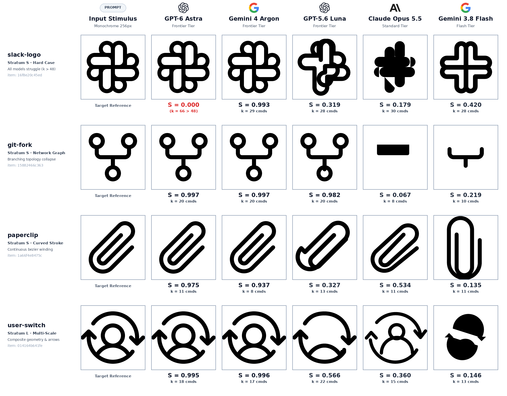
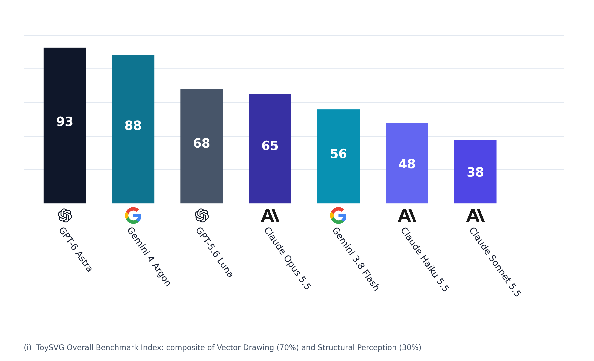
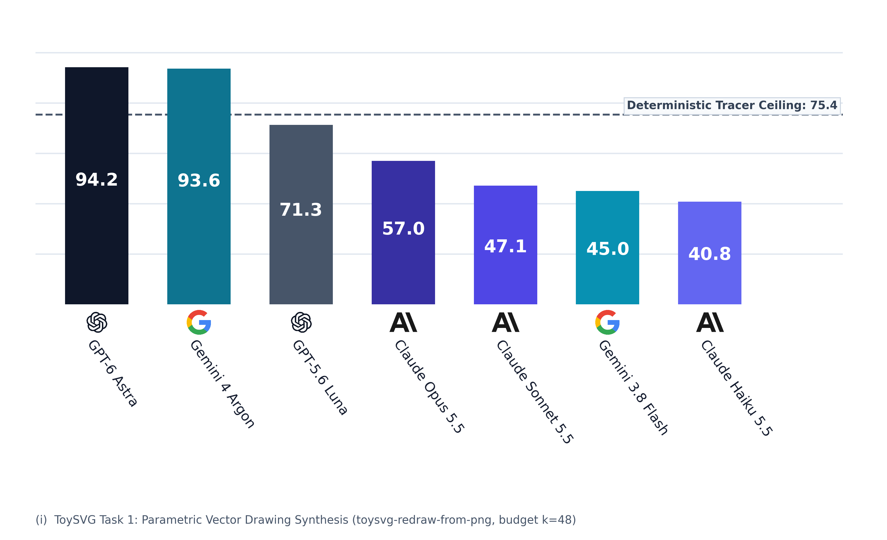
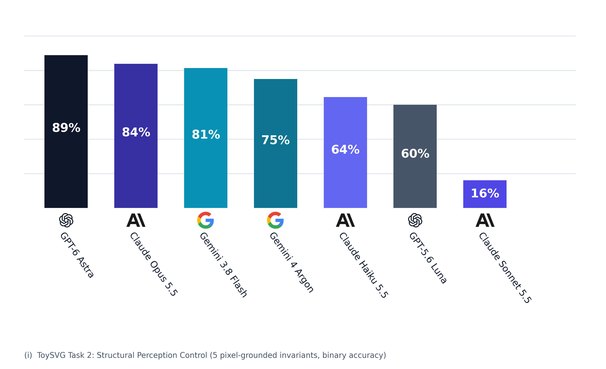
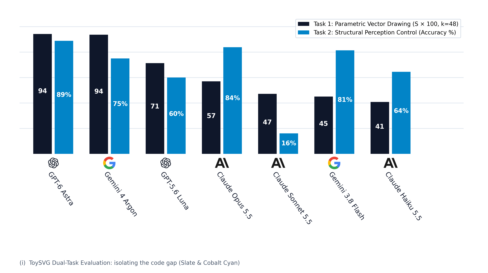

# ToySVG: Benchmarking Geometric Perception and Vector Reconstruction Under Parsimony Budgets



ToySVG is a deterministic benchmark evaluating geometric perception and vector path reconstruction from raster images under explicit command budgets $k \in \{16, 48, 160, \infty\}$. The model receives a single monochrome input image rendered from a hidden SVG path on a $256 \times 256$ coordinate canvas and synthesizes vector path commands reproducing the target geometry. The scoring pipeline is an exact closed-form function of the predicted and target paths.

Full specification paper (45 pages): **[`docs/ToySVG_Benchmark_Specification_v0.1.pdf`](docs/ToySVG_Benchmark_Specification_v0.1.pdf)**:
construct, measurement pipeline, proofs, and validation protocol.

---

## Core Premise

A model receives one monochrome PNG, rendered from a hidden SVG path in a
`256x256` canvas. It must return path data reproducing the figure. The score is a
pure function of the two paths, so the same answer always yields the same number.

Three structural choices define the instrument:

1. **Blind input.** Prompts contain purely task instructions and canvas dimensions. File names on disk are salted hashes, preventing keyword retrieval of memorized training assets.
2. **Explicit command budgets.** $k \in \{16, 48, 160, \infty\}$ drawing commands. A pixel tracer can redraw a raster with thousands of commands; the budget constraint enforces parsimony by construction. Each tier is also scored against the best procedural tracer fitting the same budget, yielding the parsimony ratio $\rho(k) = \mathrm{score} / C(k)$.
3. **Closed-form geometric scoring.** Region overlap ($s_R$, soft IoU), boundary fidelity ($s_E$, symmetric Chamfer distance at $\tau = 3\text{ px}$), and topological conservation ($s_T$, Euler characteristic).

### Figure Reconstruction as a Perceptual Probe

Vision models frequently fail at fundamental operations required for drawing: counting overlapping components, tracking line continuity, and resolving geometric intersections. Most vision benchmarks probe these capacities via multiple-choice questions where linguistic priors can bypass visual perception. In contrast, drawing requires synthesizing hundreds of interdependent coordinate values that cannot be guessed from language alone. Figure reconstruction establishes a dense measurement of visual fidelity without judge models in the evaluation loop.

The task adopts a clinical paradigm: the Beery VMI and the Rey–Osterrieth Complex Figure tests evaluate visuomotor integration by having subjects copy figures, scoring structural accuracy and spatial placement separately. I adopt that decomposition using a deterministic scorer: spatial placement (translation and isotropic scale) is resolved via numerical alignment, while structural accuracy is evaluated directly.

### Construct Decomposition

| Sub-construct | Operationalisation |
|---|---|
| Perception | Structural control queries on identical inputs (regions, holes, symmetry, axis) |
| Abstraction | Score trajectory across budget tiers $k$, and parsimony ratio $\rho(k)$ against tracer ceiling |
| Reproduction | Composite geometric score at unconstrained budget $k = \infty$ |
| Parsimony | Gate compliance: syntax validity, budget compliance, coordinate canvas bounds |

The instrument focuses strictly on structural geometry: coordinate bounds, region topology, and path continuity.

---

## Leakage Mitigation and Split Architecture

Phosphor icons are among the most mirrored SVG assets on the web, so a model may
have them memorised and win by recall while the PNG stays decorative. The corpus
is therefore split by how much a memorised answer can help, and the difference
between the splits is itself a reported metric:

| Split | Items | Construction |
|---|---|---|
| `ID-CLEAN` | 27 | icons as published, blind, geometry untouched |
| `ID-DEGRADED` | 3 | same icons, input blurred, contrast-compressed and noised; geometry untouched |
| `OOD-DISJOINT` | 2 | procedurally generated paths that appear in no icon set |
| `OOD-PERTURB` | *deferred* | deformed geometry, so a recalled shape is close but wrong |

The three shipped splits total 32 items, the count reported in the abstract and
in `data/pack/manifest.json`.

On the disjoint split recall is impossible by construction, which supplies a
perception-only anchor: under a stated exchangeability assumption the clean-minus-
disjoint gap identifies the recall rate (`Δ_mem`), and the deformed split sharpens
that estimate. Version 1 ships the first three splits only; every hidden path is
the vendor's own string, unchanged, so the deformed split's bin is relabelled
rather than reused; §6.11 of the spec has the assumption, its falsification checks
and the derivation.

---

## Design Commitments

- **C1 Determinism.** The rasteriser is an integral part of this repository rather than an external dependency. Curves flatten at a fixed sample count, and coverage is point-sampled on a supersampled integer grid. Scoring is closed-form arithmetic: identical inputs produce identical byte outputs across environments.
- **C2 Algorithmic scoring.** Scores evaluate coordinate geometry directly via closed-form arithmetic, eliminating subjective judge models from the evaluation pipeline.
- **C3 Unblended diagnostic reporting.** Region, edge, and topological components are reported individually alongside the composite score, isolating topological defects from spatial coverage.
- **C4 Bounded empirical anchors.** Shape-blind floors, algorithmic tracer ceilings, and translated-copy anchors accompany each result to define the achievable score interval.
- **C5 Quantified leakage.** Generalization gaps are computed across splits to measure memorization directly.
- **C6 Pre-registration discipline.** Metrics, weights, budget thresholds, and decision gates are frozen prior to model execution.
- **C7 Corpus provenance.** Benchmark items derive from a pinned upstream release with verified licensing, verified via SHA-256 content hashes.

---

## Verification and Correctness Invariants

All software components specified in the paper are implemented. Two test surfaces run locally without external credentials: `kaggle/test_task_files.py` exercises both
Kaggle task files against a stub SDK, and `kaggle/notebook/toysvg_kaggle.ipynb`
verifies the absence of ground-truth vectors in the model pack and confirms metric
reflexivity. The reference below maps each component to its module implementation.

- **Path parsing and Bézier flattening**: [`svgbench/pathdata.py`](svgbench/pathdata.py)
- **Pinned coverage rasteriser**: [`svgbench/raster.py`](svgbench/raster.py)
- **Geometric metrics (soft IoU, Chamfer, topology)**: [`svgbench/metrics.py`](svgbench/metrics.py)
- **Similarity alignment optimization**: [`svgbench/align.py`](svgbench/align.py)
- **Corpus filtering and task generation**: [`svgbench/corpus.py`](svgbench/corpus.py), [`svgbench/tasks.py`](svgbench/tasks.py)
- **Scoring, gates, and tracer ceiling**: [`svgbench/score.py`](svgbench/score.py)
- **Model runner and diagnostic suite**: [`svgbench/runner.py`](svgbench/runner.py), [`svgbench/diag.py`](svgbench/diag.py)
- **Task verification harness**: [`kaggle/test_task_files.py`](kaggle/test_task_files.py)

Two proof-driven corrections established while writing the specification are load-bearing:

- A drafted claim `soft IoU ≥ ½·hard IoU` is **false** (sub-threshold fractional
  coverage inflates the denominator). The spec carries a correct two-sided bound
  plus the explicit counterexample.
- Proving identity exactness exposed a subtle bias in alignment: recentring on the
  prediction's boundary-point centroid rather than its area centroid nudged
  answers that were already correct. The family is now
  `p → c + s(p − c) + t`, so the identity is genuinely in the search set and an
  already-correct answer reproduces bit for bit.

---

## Quickstart

```bash
# 1. Inspect the pre-compiled 45-page specification PDF
make open         # opens docs/ToySVG_Benchmark_Specification_v0.1.pdf detached

# 2. Install dependencies & verify deterministic rasteriser
pip install -r requirements.txt
python3 -c "from svgbench.pathdata import parse_path; from svgbench.raster import render_path; \
            print(render_path(parse_path('M0 0H256V256H0Z M64 64V192H192V64Z')).sum())"   # 49152.0
```

The specification paper is available at [`docs/ToySVG_Benchmark_Specification_v0.1.pdf`](docs/ToySVG_Benchmark_Specification_v0.1.pdf).

## Repository Structure

```
docs/ToySVG_Benchmark_Specification_v0.1.pdf  specification paper (45 pages)
docs/figures/               the figures the specification embeds
LICENSE                     MIT licence for the code and harness
CITATION.cff                software citation metadata
data/pack/                  shipped task pack: 32 blind PNGs, task files, manifest
data/pack/LICENSE-phosphor-icons.txt  upstream corpus licence, redistributed verbatim
svgbench/pathdata.py        SVG path parsing, flattening, affine transforms
svgbench/raster.py          deterministic supersampled coverage rasteriser
svgbench/svgdoc.py          document parsing, stroke expansion, dual paint reading
svgbench/metrics.py         soft IoU, boundary distances, topology, composition
svgbench/align.py           deterministic similarity alignment
svgbench/corpus.py          outline filter, strata, licence-pinned source fetch
svgbench/tasks.py           task pack: blind PNGs, task files, 3 splits shipped
svgbench/prompts.py         the frozen prompt protocol, versioned
svgbench/runner.py          model runner: providers, throttling, resume
svgbench/score.py           gates, alignment, metric terms, floors, tracer ceiling
svgbench/diag.py            response-matrix validation battery
tools/explain_score.py      the full arithmetic of one score, stage by stage
kaggle/toysvg_task_file.py the Kaggle Benchmarks drawing task (push with the CLI)
kaggle/toysvg_control_task_file.py the structure-only control task
kaggle/toysvg_task.py      the bridge: prompt, scoring, decomposition, dry run
kaggle/notebook/toysvg_kaggle.ipynb reader notebook: replay or own-key modes
tools/make_kaggle_bundle.py export code + pack + ground truth as a Kaggle dataset
tools/figstyle.py           shared colours and helpers, so primers and demos match
tools/make_metric_primers.py model-free primers: what each quantity measures
tools/make_metric_figures.py the same terms applied to the real model answers
tools/kaggle_report.py      retrieved Kaggle runs -> results table, figures, answer plates
Makefile                    convenience automation (open specification PDF)
```

## Reproducibility Protocol

Scores are deterministic, so a published number can be verified by re-running one
command on the same pack. The shipped manifest records the upstream release and
version, the acceptance filter, the stratum cuts, and the content hash of every input
PNG, which makes a result citable to an exact pack rather than to "the icons". The
sampling seed, the salt behind the item ids, and the hidden ground-truth paths are
withheld: item ids are salted hashes of the upstream asset names, and publishing the
salt would make them reversible. The Kaggle dataset bundle built by
`tools/make_kaggle_bundle.py` carries its own copy of the ground truth, so a retrieved
run stays verifiable.

### Specification Reproduction Commands

```bash
# 0. fetch and extract the pinned corpus, once (MIT, Phosphor 2.1.1)
python3 -c "from svgbench.corpus import fetch_phosphor; print(fetch_phosphor())"

# 1. build a task pack: outline filter, strata, four splits, blind I/O.
#    Bounded pool, parallel, cached -- about 20 s, not ten minutes.
python3 -m svgbench.tasks \
  --assets data/cache/phosphor-2.1.1/package/assets \
  --out data/pack --per-stratum 4 --weights regular --budgets B1 --pool 180 --jobs 8

# 2. run one model over three items at budget B1 (k=48).
#    --thinking-budget 0 is required for reasoning models: see the note below.
python3 -m svgbench.runner \
  --pack data/pack --out data/runs/gemini-2.5-flash-demo \
  --provider gemini --model gemini-2.5-flash --key-file ~/.api-keys --key-index 2 \
  --thinking-budget 0 --max-output-tokens 8192 --min-interval 20 \
  --only 01001100afd9128f,1009c27db94bba51,099fb352d58496d1

# 3. score: gates, alignment, three metric terms, floors, tracer ceiling
python3 -m svgbench.score --pack data/pack --run data/runs/gemini-2.5-flash-demo

# 4. the response matrix: does the instrument respond as specified?
python3 -m svgbench.diag --pack data/pack \
  --only 01001100afd9128f,1009c27db94bba51,099fb352d58496d1 \
  --out data/analysis/response-matrix-demo.json

# 5. the figures in the specification, built from the stored answers
python3 -m tools.make_figures --pack data/pack \
  --run data/runs/gemini-2.5-flash-demo \
  --out docs/figures --table data/analysis/demo-table.json --budget-figure

# 6. the full arithmetic of one score, stage by stage. Add --json-out to keep it.
python3 -m tools.explain_score --pack data/pack \
  --run data/runs/gemini-2.5-flash-demo --item 01001100afd9128f

# 7. Reference metric quantities on synthetic geometry (bands, canonical topology cases, alignment ladder):
#    two bands, four canonical topology cases, an alignment ladder, the anchor
#    ladder, and the weights. These figures validate measurement instruments
#    prior to empirical evaluation: the region term matches its closed form
#    to 0.00000, and boundary checks land within thresholded-mask quantisation.
python3 -m tools.make_metric_primers --pack data/pack --out docs/figures

# 8. the same terms applied to the real answers
python3 -m tools.make_metric_figures --pack data/pack \
  --run data/runs/gemini-2.5-flash-demo --out docs/figures

# 9. Kaggle benchmark reporting: parses retrieved runs to generate summary tables and answer plates:
#    the means, gate compositions, and per-item grids derive directly from run logs.
#    Writes the results table, Figures 13-14, answer plates, and LaTeX summary fragments.
python3 -m tools.kaggle_report --runs data/kaggle-runs --figures docs/figures
```

Command 6 is the one to reach for when a score seems wrong. It prints the command
count, both ink areas, the fitted transform, the soft intersection and union behind
the region term, both directed boundary means behind the edge term, the topology
counts, the three weighted contributions, and the anchors, and cross-checks its
own sum against the scorer, reporting whether the two agree. Its output for the
first demo item is reproduced verbatim in the specification.

`--key-file` is a placeholder path: pass your own, or set `GEMINI_API_KEY` in the
environment, which takes precedence over any configuration file. Credentials remain unwritten
to disk. Only an 8-character fingerprint of the key is recorded, sufficient to identify
separate keys in a report while preventing credential recovery.

### Measured Baseline Properties

Three items, one per complexity stratum, all in the clean in-distribution split,
scored from the same pixels at the same budget:

| item | stratum | commands spent | region | edge | topology | score | ceiling | parsimony |
|---|---|---|---|---|---|---|---|---|
| `01001100` | S | 9 of 48 | 0.254 | 0.065 | 1.000 | **0.262** | 0.899 | 0.29 |
| `1009c27d` | M | 25 of 48 | 0.191 | 0.020 | 0.200 | **0.132** | 0.889 | 0.15 |
| `099fb352` | C | 26 of 48 | 0.266 | 0.043 | 0.143 | **0.176** | 0.482 | 0.37 |

The decomposition provides detailed structural diagnosis beyond aggregate numbers: all three
baseline answers operated well within command budget allowances. The bounding-box floors on those
same items are 0.214, 0.166 and 0.149, indicating that two of three answers barely exceed
drawing a bounding rectangle. The row-1 answer achieves perfect topology and a 1.004 area ratio
while its region term is 0.25 (correct topology with misaligned proportions), a diagnostic
distinction unattainable from aggregate scalar metrics alone.

On an evaluation run across models, scores ranged from 0.000 to
0.877 with items gated to zero, and one item reached ρ = 1.30: 0.639
against that item's tracer ceiling of 0.492, using **12 of 48** commands. The
model beat the tracer while spending a quarter of the allowance, which is the
signature the specification predicts for reconstructing a shape rather than
sampling its pixels.

### Harness Execution Parameters

1. **Reasoning models spend the output budget on hidden reasoning.** With the
default setting, 11 of 12 answers came back truncated mid-path at about 120 visible
tokens, so the run measured the harness's token cap rather than the model's
perception. The runner records the thinking setting in the manifest for this reason.
2. **Free API tiers are limited per minute, and retries amplify the rate.** Four
parallel workers produced five `429`s in twelve calls; the same twelve calls,
spaced twenty seconds apart, all succeeded. Use `--min-interval` rather than a
large `--retries`.

Runs are resumable: results are appended to `results.jsonl` as they complete, and
re-running the same command skips items already answered. A `--deadline` bounds the
wall-clock time, so a quota stall costs you time and not data.

## Empirical Benchmark Leaderboard

ToySVG evaluates frontier multimodal systems across two complementary tasks on the identical 32-item test pack:
1. **Parametric Vector Drawing ($k \le 48$)**: Measures closed-form geometric fidelity ($S \in [0, 1]$) under strict command parsimony.
2. **Structural Perception Diagnostic**: Evaluates 160 objective geometric queries (regions, holes, mass distribution, lateral symmetry, dominant axis) without code synthesis.

### Overall ToySVG Benchmark Index

The canonical ToySVG Benchmark Index integrates normalized vector drawing performance and structural perception diagnostic accuracy with equal weighting ($50\% / 50\%$).



### Task-Level Leaderboards

#### Task 1: Parametric Vector Drawing Leaderboard

Measures spatial coordinate path reconstruction fidelity ($S$) under budget $k=48$ alongside the deterministic procedural tracer ceiling ($75.4$).



#### Task 2: Structural Perception Diagnostic Leaderboard

Evaluates 160 objective geometric queries on the identical inputs without code synthesis, isolating perceptual parsing accuracy.



### Dual-Task Breakdown and the Code Gap

Comparing structural perception accuracy against parametric vector reconstruction isolates the *code synthesis gap*: models frequently perceive discrete geometric invariants with high accuracy yet fail to synthesize valid, compact coordinate paths under budget constraints.



### Frontier Model Performance Summary

| Model | Provider | Overall Index | Vector Drawing ($S$, $k=48$) | Perception Accuracy | Parsimony Ratio ($\rho$) | Failure Gates |
|---|---|---|---|---|---|---|
| **GPT-6 Astra** | OpenAI | **92.6%** | **94.2** | **88.8%** (142/160) | 1.291 | 1 budget gate |
| **Gemini 4 Argon** | Google | **88.0%** | **93.6** | 75.0% (120/160) | 1.366 | 1 syntax gate |
| **GPT-5.6 Luna** | OpenAI | **67.9%** | 71.3 | 60.0% (96/160) | 0.967 | 0 gates (32/32 valid) |
| **Claude Opus 5.5** | Anthropic | **65.0%** | 57.0 | 83.8% (134/160) | 0.747 | Geometric degradation |
| **Gemini 3.8 Flash** | Google | **55.9%** | 45.0 | 81.3% (130/160) | 0.612 | Spatial budget stalls |
| **Claude Haiku 5.5** | Anthropic | **47.9%** | 40.8 | 64.4% (103/160) | 0.516 | Command exhaustion |
| **Claude Sonnet 5.5** | Anthropic | **37.8%** | 47.1 | 16.1% (26/160) | 0.591 | Invariant collapse |
| *Procedural Tracer Ceiling* | Reference | *N/A* | *75.4* | *N/A* | *1.000* | *Deterministic limit* |

## Kaggle Benchmarks Deployment

The ToySVG benchmark is hosted on [Kaggle Benchmarks](https://www.kaggle.com/benchmarks/tasks/riadmohamed42/) across two complementary evaluation tasks:

* **Vector Reconstruction Task**: [`toysvg-redraw-from-png`](https://www.kaggle.com/benchmarks/tasks/riadmohamed42/toysvg-redraw-from-png/2)
  Evaluates spatial vector path synthesis under parsimony command budgets ($k \le 48$) from blind monochrome inputs.
* **Geometric Perception Control**: [`toysvg-structure-questions`](https://www.kaggle.com/benchmarks/tasks/riadmohamed42/toysvg-structure-questions/2)
  Evaluates 5 objective geometric invariants (regions, holes, mass centroid, lateral symmetry, dominant axis) on the identical inputs without code synthesis.
* **Companion Dataset Harness**: [`riadmohamed42/toysvg-benchmark-harness`](https://www.kaggle.com/datasets/riadmohamed42/toysvg-benchmark-harness)
  Carries the evaluation harness, the deterministic rasteriser, the blind test pack, and the scoring verification suite.

Evaluations execute directly on Kaggle's infrastructure through its unified model proxy, ensuring that every model evaluates against identical inputs, budgets, and scoring environments without requiring personal API credentials. Detailed developer and CLI instructions reside in [`kaggle/README.md`](kaggle/README.md).

## Attribution and License

The corpus is derived from **Phosphor Icons 2.1.1 (MIT)**; see
[`ATTRIBUTION.md`](ATTRIBUTION.md) for the alternatives considered, and
[`data/pack/LICENSE-phosphor-icons.txt`](data/pack/LICENSE-phosphor-icons.txt) for
the upstream licence redistributed verbatim. Results must reproduce that attribution.

The repository code and harness are released under the MIT Licence; the text is in
[`LICENSE`](LICENSE). The built specification is covered by the same terms.

## Citation

[`CITATION.cff`](CITATION.cff) carries the software citation. Cite the specification paper (*ToySVG: Benchmarking Geometric Perception and Vector Reconstruction Under Parsimony Budgets*, `docs/ToySVG_Benchmark_Specification_v0.1.pdf`, v0.1, 2026) alongside it. An arXiv / Zenodo identifier will be added to `CITATION.cff` upon preprint publication.
